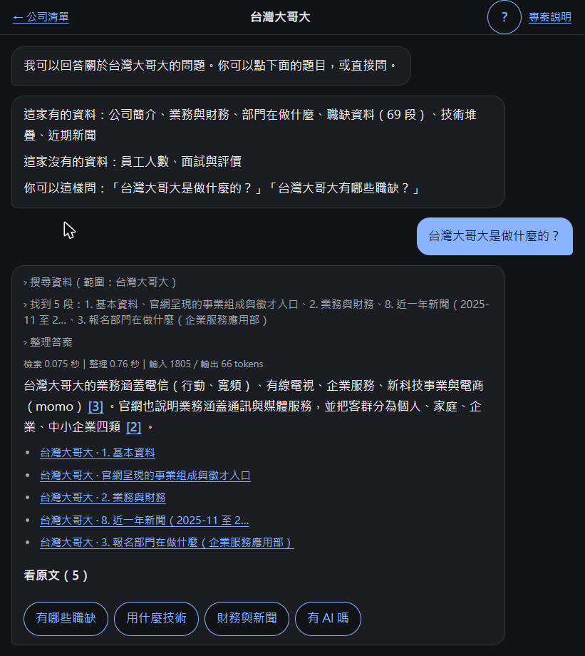

# 求職情報問答

個人求職用的 RAG 問答工具。它讀我整理的公司調查檔，回答「這家公司做什麼」「有哪些職缺」這類問題。每個答案都附出處。找不到把握的內容時，它回「找不到」，不編答案。



上圖是 2026-11-24 在本機用真實 DeepSeek 拍的。`demo/screens/` 的 01 到 08 是開發用替身的示意圖，頂端有紅條註明。

## 做法

1. **檢索**：bge-m3 在本機把問句和段落轉成向量，取最相近的 5 段。
2. **查無門檻**：最高相似度低於門檻，就回「找不到」，不呼叫 LLM。
3. **整理答案**：DeepSeek 只讀檢索到的段落，寫出附編號出處的答案。
4. **引用檢查**：答案引用了沒送出的段落編號，整個答案擋下。

索引只收公開事實段落。私人筆記在載入語料時就丟掉。

## 成績

獨立測試題 100 題由另一個模型出題。這些題沒有用來調任何參數。

| 項目 | 結果 | 題數 |
|---|---|---|
| 檢索 MRR（bge-m3） | 0.867，95% 區間 [0.801, 0.923] | 72 |
| 檢索 Hit@3 | 0.931 | 72 |
| RAGAS 忠實度 | 0.982 | 69 |
| RAGAS 答案相關性 | 0.824 | 69 |
| 逐句複查：有依據的陳述 | 206 / 212 | 69 |

RAGAS 與逐句複查的評審是 Claude Sonnet 5.5。

**檢索方式的取捨**（同一批 72 題，和 bge-m3 比 MRR）：

| 方式 | MRR | 和 bge-m3 的差 | 結論 |
|---|---|---|---|
| bge-m3 | 0.867 | — | 採用 |
| BM25 + bge-m3 混合 | 0.798 | -0.069，區間 [-0.123, -0.026] | 比較差 |
| bge-m3 + reranker | 0.910 | +0.043，區間 [-0.012, +0.103] | 區間含 0，不能說有差；CPU 每題約 7 秒，沒有上線 |

另外在 25 題上比過 5 種方式（BM25、bge-small-zh、bge-m3、e5-large、混合），結果在 `eval/results_methods.txt`。

## 限制

- 獨立測試題由單一模型出題，金標沒有經過人工確認。
- 評審只跑一次，輸出有隨機性。
- 查無門檻用 30 題挑出，拒答率偏樂觀。
- 問全部公司的技術名詞題，多數被門檻擋掉。有答案和沒答案的題，最高分混在一起，門檻分不開。

## 跑法

```
pip install -r requirements.txt
set JOB_RAG_CORPUS=<語料資料夾>      # 完整語料不進 git
python -X utf8 app.py                # 開 http://localhost:5000
python -m pytest tests               # 用假語料，不需要模型
```

Windows 也可以雙擊 `start.bat`。整理答案需要 `.env` 裡的 `DEEPSEEK_API_KEY`（範本是 `.env.example`）。

## 文件

- [詳細說明](docs/details.md)：每個功能的做法、每次評估的指令與結果、每個決定的理由。
- `SPEC.md`：規格。`GLOSSARY.md`：名詞。
- `eval/`：評估題、評估程式與原始結果。
- `demo/screens/`：畫面截圖。
